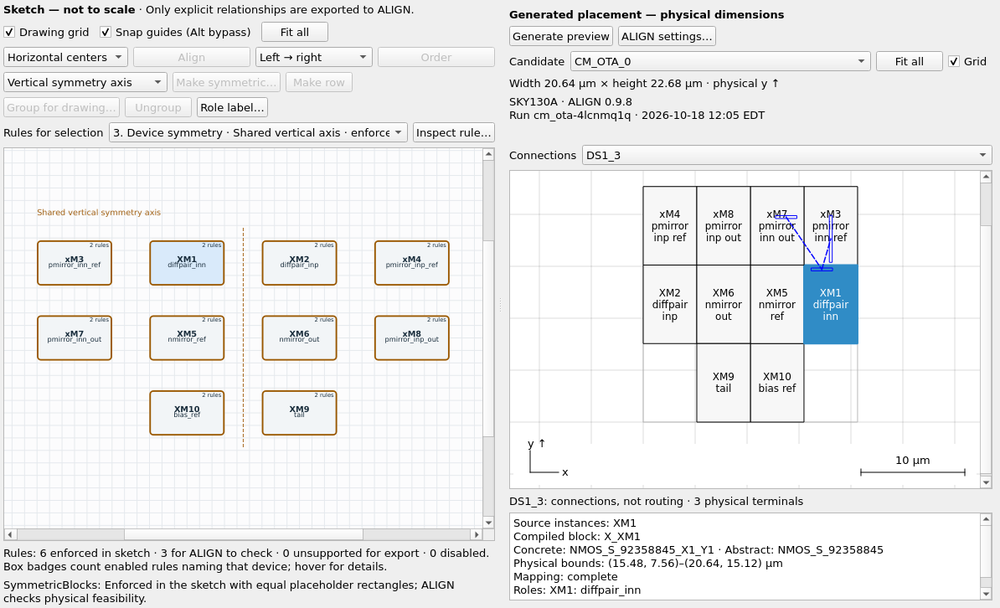
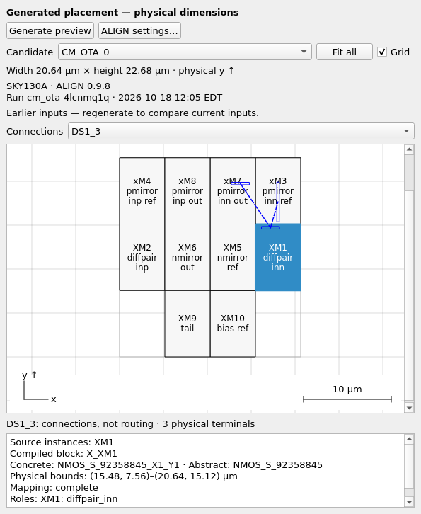
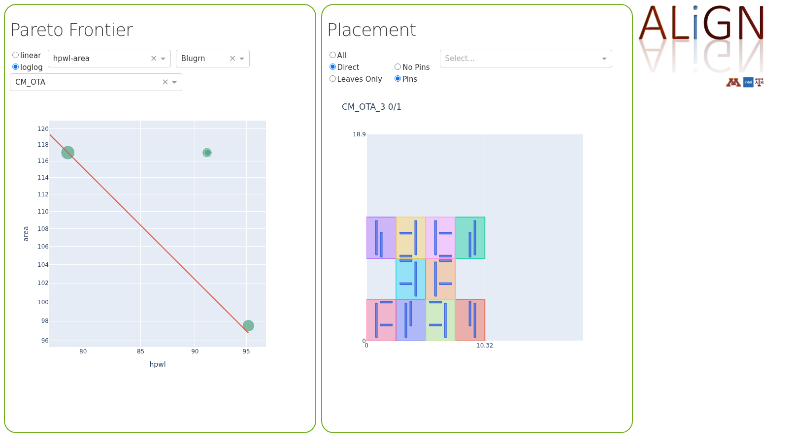
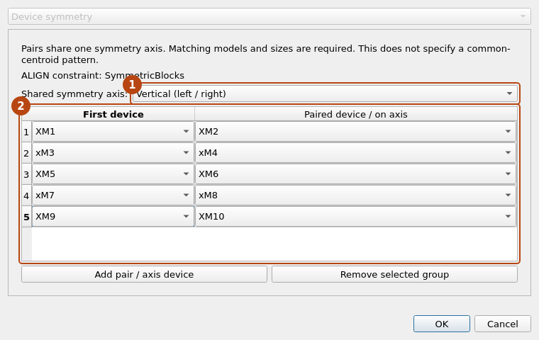
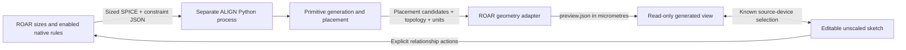
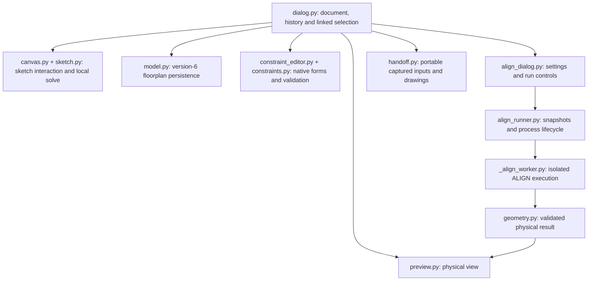

# Graphical floorplanning with ALIGN

The layout button in ROAR's header opens two connected views: an editable
**Sketch** of placement intent and a read-only **Generated placement** from
ALIGN. Arrange device rectangles, create explicit alignment, order or symmetry
rules, then generate physical candidates to compare with the sketch. ROAR keeps
the device sizes, native constraints and captured results together in one workflow.

The sketch is **not to scale**. Its equal-sized boxes help organize a circuit;
the generated view shows actual completed ALIGN placements, with selected
primitive variants and physical dimensions. Only explicit native constraints
are sent to ALIGN. Dragging, snapping and drawing groups save your drawing
without changing generation inputs or making a physical result stale.

The editor uses ROAR's existing Qt interface and netlist parser. Set up the
checkout once, then launch it:

```sh
./bin/setup_roar.sh && ./bin/roar
```

Sketching and export work without ALIGN. The normal setup also prepares a
separate ALIGN environment and the SKY130 backend so physical generation needs
no manual interpreter paths. Xschem, Magic and a foundry PDK installation are
not needed for this placement workflow; routing and signoff remain separate.

## Set up the ROAR desktop

Setup installs the locked Pixi runtime under the checkout's `.pixi` directory:
Python 3.11 for ROAR, native graphics libraries, and Python 3.10 for ALIGN.
It verifies the pinned Pixi 0.75.0 download and configures the placement backend.
No system Python, `sudo`, virtual environment activation or Conda shell commands
are required. The launcher always selects this checkout's managed environment
and runs offline. Rerun setup after updating or moving the checkout.

The Linux x86-64 target requires glibc 2.28 or newer and kernel 4.18 or newer.
The managed runtime has been exercised on Ubuntu 22.04 under WSLg; other Linux
distributions have not yet been validated. The host supplies the desktop display
and graphics driver. See [Installation and Usage](INSTALLATION_AND_USAGE.md)
for bootstrap requirements, diagnostics and the expert manual Python fallback.
Python 3.11 remains a required ROAR compatibility target.

Normal startup checks the GUI before opening the application; missing libraries
or display failures produce repair guidance instead of a Qt crash or traceback.
Use `./bin/roar --check-gui` to run that check alone, or
`./bin/roar --check-setup` to also check the configured ALIGN installation.
The checks do not install packages or generate a placement. Ordinary desktop
startup does not execute ALIGN, though the managed launcher requires a complete
installed runtime. Authoring and export themselves do not use ALIGN.

Under WSL, use WSL2 with a working WSLg desktop connection; follow Microsoft's
[Linux GUI application setup](https://learn.microsoft.com/en-us/windows/wsl/tutorials/gui-apps).
Launch from that Ubuntu terminal so its `DISPLAY`/`WAYLAND_DISPLAY` are available.
If the Wayland/OpenGL path fails, try `QT_QPA_PLATFORM=xcb ./bin/roar`.
An SSH or container session also needs display access to show the editor.

| Startup problem | What to do |
| --- | --- |
| Managed runtime missing or out of date | Run `./bin/setup_roar.sh` from this checkout. Launch does not install packages. |
| Missing GUI package or native `.so` | Rerun setup and inspect its failed check. For a manual Python installation, repair that environment and its administrator-provided native libraries. |
| Qt cannot load `xcb` or connect to the display | Run `./bin/roar --check-gui`; check the desktop/WSLg connection and graphics driver. |
| The checker reports `offscreen` or `minimal` | Only a headless Qt check ran. Remove that `QT_QPA_PLATFORM` override and rerun from the desktop terminal to check visible windows. |
| ALIGN configuration is missing | Rerun setup for the managed toolchain, or configure an intentional external installation in **ALIGN settings**. Generation opens settings directly when configuration is invalid. |

`QT_QPA_PLATFORM=offscreen` is useful for automated tests but does not provide an
interactive desktop or establish graphics-driver compatibility.

## Main controls

Open the [linked OTA example](#try-a-linked-parameterized-ota) to try the two
views side by side on **Floorplan**. Sketching requires no ALIGN installation;
the normal checkout setup prepares the separate environment used for physical geometry.

| Task | Control and result |
| --- | --- |
| Arrange the sketch | Select boxes or rubber-band a selection, then drag. Wheel zooms; middle-drag pans; **Fit all** restores the view. **Alt** temporarily bypasses snap guides. **Escape** cancels a drag. |
| Keep a relationship | Select devices and use **Align**, **Order**, **Make row**, or **Make symmetric…**. These create native rules also visible in **Constraints**. A row combines center alignment with left-to-right order. |
| Move a visual group | **Group for drawing…** adds a label and moves its members together. It does not combine circuit devices or generate ALIGN hierarchy. |
| Name a device's function | Select one sketch box and choose **Role label…**. Labels such as `tail` appear beside the original instance ID and in physical-block details. They do not rename devices or change ALIGN inputs. Clear the label to remove it. |
| Refine or disable a rule | Use **Constraints**. Selecting a row highlights its participants; the sketch explains whether the rule is enforced locally, exported for ALIGN to check, unsupported, or disabled. |
| Find a device's rules | Hover over its box for rule summaries, or select it and use **Rules for selection → Inspect rule…**. Badges count enabled rules naming that device directly; whole-circuit and net rules remain in **Constraints**. Conflicts keep a visible warning until repaired or disabled. |
| Inspect a physical result | **Generate preview** runs ALIGN through placement. Choose a **Candidate**, inspect dimensions and provenance, and select a net under **Connections**. Selection links known source devices across the views and **Devices**. |
| Keep working after an input change | The previous result stays visible with **Earlier inputs**. Generate again after changing sizes, enabled rules, technology or run options. |
| Give the design to a layout engineer | **Export handoff…** creates a portable ZIP of captured inputs and drawings; optionally include the displayed physical candidate with its own captured inputs. |



**1** Drag the sketch boxes. **2** Create relationships that ALIGN will honor.
**3** Compare a physical candidate; selecting devices highlights both views.

**Undo** and **Redo** cover the sketch and forms together; one completed drag is
one edit. Save and reopen the floorplan to retain positions, drawing groups,
sizes and rules. Snap guides are temporary. Use an explicit relationship action
when the relationship should survive future moves and be exported.

The live sketch enforces `Align`, `Order`, `AlignInOrder` and `SymmetricBlocks`
using placeholder rectangles. Other supported rules, including `Floorplan`
regions and physical spacing, remain available in the forms for ALIGN to check.
A local conflict preserves the prior feasible drawing; edit or disable the
reported rule in **Constraints**. Sketch feasibility does not establish that
physical device geometry will fit.

The physical preview is read-only. A compiled block may represent several source
devices; selecting it highlights the known members together. Details identify
the compiled block and chosen primitive template. Incomplete source mapping is
marked explicitly. Selected-net lines show connectivity, not routed wires or
parasitics. Exact physical-coordinate editing, routing and circuit hierarchy
rewrites are outside this workflow.

## A companion to the ROAR design

The editable layout data lives in a separate `.roar.floorplan` file.
It contains the circuit template, chosen subcircuit, size values and bindings,
placement constraints, and an optional link to a saved ROAR design. ROAR's
existing `.roar` format is unchanged. Switching to an associated design requires
an explicit choice when it conflicts with the current design. Existing
`.floorplan.json` files still open.

The usual workflow is **New floorplan…** or **Open floorplan…**, edit the sizes
and constraints, **Save**, then **Export ALIGN inputs…** when ready for ALIGN.

| Action | What it reads or writes |
| --- | --- |
| New floorplan… | Reads a circuit netlist to start a new floorplan. A ROAR design can optionally supply sizes. |
| Open floorplan… | Restores a complete saved floorplan: circuit, sizes, source bindings and placement constraints. |
| Save / Save as… | Writes that complete editable document as `.roar.floorplan`. |
| Export ALIGN inputs… | Writes the sized circuit netlist and placement constraints together in ALIGN's required formats. |
| Advanced: Load ALIGN constraints… | Reads only placement rules from an existing ALIGN constraint file. Choose whether to add them or replace the current rules; the circuit, sizes and ROAR link stay unchanged. |

Constraints belong to the floorplan and are saved with it. A separate constraints
file is only needed to exchange rules with ALIGN or another tool. There is one
export action, which includes both the sized netlist and the constraints.

**Open floorplan…** offers a sizing source: **Current ROAR design**, **Open another
ROAR design…**, or **Captured sizes (no updates)**. Opening another design changes
ROAR's active design and keeps bound sizes live; selecting its already active
file uses the current unsaved sizes. In a standalone editor, **Saved ROAR file**
reads the file without changing a ROAR workspace. The selected mode is saved with the project;
older projects reopen their captured sizes without silently refreshing a link. Missing links can be
repaired with Browse, or the floorplan can open using its saved sizes alone.

If the associated design differs from the active design, a conflict dialog
offers switching to the associated design, associating the floorplan with the
current design, using captured sizes, or cancelling. This also applies when a
saved floorplan reopens in live mode, even if the two designs have identical
sizes. Unsaved design changes add **Save and Switch**
and **Discard and Switch** choices. Cancelling or failing a save cancels the
switch. An unnamed current design must be saved before making a persistent
association. Switching changes the design editor's data; graph tabs and window
layout stay in place.

Links are saved relative to the companion file. Moving the two files together
preserves their association, and **Save as…** rebases the link to the same design.
The original netlist text is embedded, so it remains available even if its
original file moves. Versions 1–5 still open; new saves use version 6, adding
device role labels to the sketch positions, drawing groups, stable rule identities,
sizes, bindings and run options. An unnamed live design's floorplan saves as captured
sizes until a source is explicitly associated; reopening never binds it to an unrelated active design.
Machine settings, run history and generated
geometry are stored separately from the floorplan and the `.roar` design.

An asterisk in the title marks unsaved floorplan edits. Closing the editor,
switching documents, or exiting ROAR offers Save, Discard, and Cancel. Saving
the application state also saves a modified floorplan companion; it does not
embed the floorplan into the `.roar` file. Undo and Redo cover manual device,
parameter and constraint edits, including temporary invalid cell text.

**Captured sizes (no updates)** restores the captured sizes without a live source.
**Current ROAR design** keeps explicitly bound parameters up to date with the
design editor. Manual values are preserved. A live source is refreshed again
before generating placement or exporting, so a missing or invalid binding
blocks those actions rather than exporting its old value.

## Try a linked, parameterized OTA

1. Click the header's layout button, then **Open floorplan…** and choose
   [`cm_ota.roar.floorplan`](../examples/floorplan/ota/cm_ota.roar.floorplan).
   Its linked [`cm_ota_sizes.roar`](../examples/floorplan/ota/cm_ota_sizes.roar)
   is retained as its association. Open with **Captured sizes (no updates)**, or choose
   **Open another ROAR design…** to open its linked design as the live sizing
   source (**Saved ROAR file** in a standalone editor).
2. Inspect the **Parameters** tab. Each shared symbol lists its affected device
   fields, captured value and ROAR source. For example, `w1_2` is bound to
   `M1_2.W`. W is 2.2 µm total, NF is 2, and the Devices tab therefore shows
   1.1 µm per finger. These are synthetic demo sizes, not optimized designs.
3. Select a parameter to enter a manual value or bind a different resolved ROAR
   instance attribute. Manual assignment replaces that parameter's binding.
   Clearing its value makes it unresolved again. Shared symbols update all
   their device references together.
4. Arrange devices in the **Floorplan** sketch and use an explicit relationship
   action when needed. Use **Save** or **Save as…**, then **Generate preview**
   to compare the drawing with a physical OTA placement. To run ALIGN manually
   elsewhere, **Export ALIGN inputs…** creates a fresh circuit directory with sized SPICE and native
   constraint JSON.

This example embeds the actual [`design/cm_ota.spice`](../design/cm_ota.spice)
template. To start from scratch instead, choose **New floorplan…**, select
that file, and choose micrometres and total width. Optionally select
`cm_ota_sizes.roar` as the sizing source in the same dialog. The template loads
with unresolved widths and finger counts; you can save that draft and author
constraints before assigning all values. Export waits for complete, valid sizes.

The source template makes `XM10` refer to `nf1_2`, while `XM9` refers to `nf9_10`.
The affected-device column exposes that relationship and preserves it exactly.

## Generate and inspect the OTA placement

### ALIGN configuration

`./bin/setup_roar.sh` prepares the separate ALIGN environment and matching SKY130
backend. Keep this environment separate from ROAR's Qt dependencies. Normal users
can proceed directly to generation; **ALIGN settings** remains available for
run options, diagnostics and intentionally selected external installations.
The managed launcher uses its supplied Python and backend with **Managed by ROAR**
selected. Choose **Custom installation** explicitly to use other paths. Existing
custom paths and the runs folder preference are preserved; saved paths alone do
not override managed mode.

Open **ALIGN settings… → Setup help…** for
[managed-runtime recovery and the manual installation recipe](../src/floorplan/ALIGN_SETUP.md).
The profile uses the official ALIGN 0.9.8 Python 3.10 wheel, Dash 2.18.2 and the
pinned vibeic SKY130 backend. The source reference used for compatibility checks is
[revision `8d3cc2e9`](https://github.com/ALIGN-analoglayout/ALIGN-public/tree/8d3cc2e9aa5511315203eb5cbfd00d2c88fdbd18);
the wheel is identified by its release and artifact, not assumed to equal that checkout.

**Test installation** reports versions, checks the backend, imports native
components and verifies write access to the placement runs folder. Optional
browser-viewer checks report warnings separately. It creates the runs folder
if needed, but does not install or modify the toolchain.

If generation finds missing or invalid configuration, it opens settings with
the specific issue. **Save and generate** resumes the request with the confirmed
settings; **Cancel** leaves the draft and current sizes unchanged. No discovered
Python executable is run automatically. Editing and export remain available.

### Run placement

1. Open the linked OTA example above and select **Placement**. Its saved
   backend profile selects **SKY130A** and supplies the repository's run defaults.
2. The example's **SKY130A** technology uses the toolchain configured by setup.
   Optionally open **ALIGN settings…** to change placement effort or use
   **Test installation**. Machine paths are local preferences and are not written
   into the floorplan or the linked ROAR design. Manual installations can supply
   `ROAR_ALIGN_PYTHON` and `ROAR_ALIGN_PDK_FIXED`; an intentional custom
   installation can also be selected in settings.
3. Choose **Generate preview** on **Floorplan**, or **Generate physical preview**
   on **Placement**. ROAR captures current sizes and enabled constraints, exports
   them to a new run directory, then runs ALIGN in a separate process. Progress
   and logs remain available while editing stays responsive. Native generation
   starts no web server and opens no browser.
4. Compare the sketch with a generated **Candidate**. Inspect width, height,
   scale and source-device selection, then choose a net under **Connections**.
   Geometry comes from completed placement, including the concrete primitive
   variant chosen for each compiled block. The flow stops before routing.
5. After changing generation inputs, the captured result remains visible with
   **Earlier inputs**. Generate again to apply the changes.
   Drawing-only edits leave the captured result current. Saved results reopen
   without rerunning ALIGN, including after restarting ROAR.



The captured candidate stays inspectable after an input change. Here **Connections**
shows one net's physical terminals; the dashed lines are connectivity, not routing.

**View last run / log…** reopens progress or failure details without generating
again. **Cancel generation** stops an active run; cancellation or failure keeps
the sketch and last successful preview. **Copy diagnostics** includes the run
folder and displayed log for CAD support, with viewer-link credentials removed.
The full log remains in the run folder.

**Open in ALIGN browser…** explicitly opens ALIGN's own placement explorer for
the captured result. This optional viewer starts a local server and requires
its viewer assets, which the managed setup supplies. Native preview generation
does not depend on those assets.
The browser remains useful for ALIGN's own candidate, hierarchy, pin and net
inspection.



The repository profile is
[`align_profile.json`](../src/floorplan/align_profile.json): ALIGN 0.9.8, Dash 2,
the tested `vibeic/ALIGN-pdk-sky130` backend revision, four requested candidates,
100 placement iterations and seed zero. **ALIGN settings…** exposes candidate
count, placement effort, random seed, and wirelength weight. These choices are
saved in the floorplan and captured for each run. The initial 100 iterations
are a quick preview; ALIGN's usual default is 10,000. These are demonstration defaults;
ALIGN may return fewer distinct candidates. The profile checks the backend
files that determine MOS geometry. The generic `ROAR_ALIGN_PDK` variable is not
used because it can refer to a backend with different geometry behavior.

When explicitly opened, the browser explorer is served on the local machine
with its debugger disabled. Each run uses an authenticated browser link; open it from ROAR. Foreign hosts and
cross-origin requests are rejected, including requests to Dash callbacks.
Closing a browser tab does not stop its server; use the run controls or close
the floorplan editor. Native preview generation exits after writing its result.
Captured inputs and generated artifacts remain available
after stopping, including across ROAR restarts. Runs are associated with the
saved floorplan path. Saving an unsaved floorplan before running gives it a
stable identity for reopening results. **Save as…** moves the current run's
association to the new floorplan path without restarting ALIGN.

Technology choices come from ROAR's sizing library. A characterization library
alone does not provide an ALIGN layout generator: technologies without a
configured backend remain visible but unavailable for generation. The included
backend supports four-terminal SKY130 1.8 V NMOS and PMOS models. Unsupported
devices are reported by name; device count is not restricted to the OTA example.
The OTA remains the included demonstration and native acceptance circuit.

## Create an OTA floorplan from a numeric netlist

1. Click the layout button, then **New floorplan…**. Choose
   [`current_mirror_ota.sp`](../examples/floorplan/ota/current_mirror_ota.sp).
   The import dialog selects the only subcircuit automatically. Choose a circuit
   from the dropdown for files containing several. Units and width convention
   appear together in the same dialog; keep micrometres and width per finger for
   this example. Its explicit SPICE suffixes take precedence over the unit
   selector.
2. Edit **W per finger (µm)**, **L (µm)**, **NF**, and **M** on the Devices tab. Sizes
   are synthetic geometry examples, not optimized or simulation-qualified designs.
   Positive integer NF values can be imported and saved as drafts; this SKY130
   generator requires even NF of at least two before placement. Effective width
   includes both NF and multiplicity. The terminal/net inspector shows the
   selected device's connectivity. Numeric resistor values are editable too,
   although the included placement backend supports MOS devices only.
3. On the **Constraints** tab, add a constraint and select its devices and
   settings. Each constraint has its own readable row; select a row to edit
   or remove it. For this example, you can also expand **Advanced** and use
   **Load ALIGN constraints…** to read the sibling `.const.json` file.
4. Use **Save** to retain your work.
   The project includes the original netlist text, edited sizes and constraints;
   reopening does not depend on the original file still being present.
5. **Export ALIGN inputs…** asks for a parent folder and creates a fresh
   `<subcircuit>/` directory containing `<subcircuit>.sp` and
   `<subcircuit>.const.json`. Existing bundle directories are refused, so choose
   another parent folder for a new revision.

The OTA contains ten MOS devices. Its example constraints pair devices around a
shared vertical axis and align each pair's horizontal centers.

The import unit selector applies only to numbers without a suffix: with
micrometres selected, `L=0.5` means 0.5 µm. Select metres for a netlist that writes
the same dimension as `L=0.5e-6`. `L=0.5u` means 0.5 µm with either selection.
The editing table always uses micrometres, and export converts to SI. The headless
`from_netlist` API retains its metre default; pass `dimension_unit="um"` for bare
micrometre inputs.

## Placement intent

Each constraint appears as a row with its type, affected devices or ports, and
settings. Add a constraint through its form, or select an existing row and edit
it (double-clicking also opens the form). Changes are validated before applying;
cancelling leaves the constraint unchanged. No JSON editing is needed.



**1** Choose the shared axis. **2** Pair devices, or place a singleton on that axis.

See ALIGN's
[constraint reference](https://align-analoglayout.github.io/ALIGN-public/notes/const.html)
for the underlying semantics.

| Editor intent | Native ALIGN constraint | Meaning |
| --- | --- | --- |
| Device symmetry | `SymmetricBlocks` | All pairs share one horizontal or vertical axis. An additional singleton can sit on that axis. |
| Relative order | `Order` | Left-to-right or top-to-bottom order; reverse the device list for the opposite order. Optional abutment requests touching edges. This does not also align centers. |
| Align centers / edges | `Align` | Align centers or edges along the selected horizontal or vertical line. |
| Rows / regions | `Floorplan` | Regions run from top to bottom. Optionally order devices left to right within each row, or mirror them around one shared vertical axis. Add `Align` separately when row centers must coincide. |
| Packing | `CompactPlacement` | Request left, right or centered packing for the entire circuit. |
| Place closer | `PlaceCloser` | Encourage selected devices to be close together. |
| Power ports / Ground ports | `PowerPorts` / `GroundPorts` | Identify supply ports, retaining their order and whether the assignment propagates into child circuits. |
| Boundary and margins | `Boundary` | Maximum width/height and margins, in µm. |
| Aspect ratio | `AspectRatio` | Bounds on circuit width/height and the native weight. |
| Minimum device spacing | `Spread` | A gap in nm between selected devices when they overlap in the other direction. |
| Circuit spacing | `BlockDistance`, `HorizontalDistance`, `VerticalDistance` | Circuit-wide gaps in nm; the placer rounds up to its routing grid. |
| Same device layout template | `SameTemplate` | Matching devices use the same physical template. This does not create a common-centroid arrangement. |
| Align and order | `AlignInOrder` | Edge/center alignment together with left-to-right or top-to-bottom ordering. |
| Port location | `PortLocation` | A boundary region for signal ports. |
| Net symmetry | `SymmetricNets` | Two nets and ordered corresponding pins, with an explicit symmetry axis. |
| Net placement priority | `NetPriority` | Select signal nets and assign a nonnegative integer wirelength weight. Larger values favor shorter connections during placement; unspecified nets have weight 1. This is not a matching or length guarantee. |
| Clock ports | `ClockPorts` | Exclude clock nets from ordinary signal symmetry inference. |
| Keep devices out of pattern recognition | `DoNotIdentify` | Prevent selected devices from being combined into recognized circuit patterns. |
| Compiler transformations | `ConfigureCompiler` | Control inference, merging, dummy removal, source/drain correction, and propagation. Defaults match ALIGN. |

Symmetric pairs must have matching models and parameters. Centered packing is a
placement preference, not a guarantee of exact centering in a fixed boundary.

Local validation checks names, fields, concrete dimensions, contradictory
ordering cycles and conflicting port roles. Use one enabled row for each
circuit-wide boundary, aspect ratio, packing or compiler setting. For circuit
spacing, use either one general row or separate horizontal and vertical rows;
overlaps are rejected because ALIGN can overwrite earlier settings. A net's
placement weight must likewise be set in only one enabled row.
Use one enabled `PowerPorts` row and one enabled `GroundPorts` row, each listing
all ports for that role in the desired order with one propagation setting.
Repeated rows are rejected even for different ports: ALIGN preprocessing uses
only the last row's list, which can change source/drain correction and device removal.
**Check constraints** also runs
native combined checks when ALIGN is configured. Generation repeats native
preflight before making primitives. These checks do not prove physical
feasibility for generated geometry. These examples are also checked with ALIGN 0.9.8's parser,
constraint verification and native placement-constraint translation. A successful
export alone does not establish DRC, LVS, model-bin validity or generated geometry.
Native-check results stay visible on **Placement**, separately from run status.
Editing the inputs marks that check out of date; run **Check constraints** again.

## Bring sizes over from ROAR


**1** See which devices share each size. **2** Bind a ROAR value and specify its
units and width convention; total W is divided by NF for the device's per-finger width.

Use the **Sizing source** selector for the current design, a saved design, or
the floorplan's captured sizes. The Parameters tab binds
one netlist symbol to one explicitly chosen instance attribute, using ROAR's
existing assigned scalar values. It records whether that binding came from the
linked file or the running design, and preserves the captured value on save.
Selecting the current design updates existing explicit bindings to that source;
it does not infer device-name mappings. Missing assignments,
disabled instances, nonfinite values and vectors are rejected; the editor does
not evaluate sweeps or select a design point on your behalf.

For a fully numeric netlist, the Devices tab also accepts explicit source-row
to target-device mappings. For example, map ROAR row `M1_2` to `M1, M2`; names
are never expanded automatically. Fields controlled by template symbols are
edited through those shared parameters instead. Numeric fields, such as a
literal L in an otherwise parameterized device, remain editable directly.

**Import numeric .param…** can populate matching symbols from a numeric SPICE parameter
file. Choose the file's units and width convention. The import is atomic:
invalid used values leave all existing sizes intact. Unused names are reported;
matched assignments replace their previous bindings. Expressions and includes
are outside this importer. Simulation parameter files with NF=1 can be imported;
choose layout-appropriate finger counts before running the SKY130 generator.

The defaults are metres for ROAR W/L and total width. When total width is selected,
the editor divides W by NF once. Its table always shows per-finger W and L in
micrometres. Export always writes SI dimensions and per-finger W. Assigned ROAR
values must be concrete scalars; unresolved template symbols can remain in a
saved draft, but prevent export.

## Python API

Run from the checkout root after installing ROAR:

```python
import json
from pathlib import Path
from roar_api.floorplan import FloorplanProject

example = Path("examples/floorplan/ota/current_mirror_ota.sp")
project = FloorplanProject.from_netlist(example)
project.set_constraints(json.loads(example.with_suffix(".const.json").read_text()))
project.set_mos_parameters("M1", width_um=1.05, length_um=0.15, nf=4)
project.save("ota.roar.floorplan")
netlist, constraints = project.export_align("floorplan-output")
```

Use `FloorplanProject.load(path)` to reopen a project. To import a resolved
`roar_api.Design`, call:

```python
project.import_roar_parameters(
    design, "M1_2", ["M1", "M2"],
    dimension_unit="m", width_convention="total",
)
```

For a template and companion association:

```python
from roar_api import Design

project = FloorplanProject.from_netlist(
    "design/cm_ota.spice", dimension_unit="um", width_convention="total")
project.roar_project_path = "examples/floorplan/ota/cm_ota_sizes.roar"
design = Design.load(project.roar_project_path)
project.bind_parameter(design, "w1_2", "M1_2", "W",
                       dimension_unit="m", width_convention="total", source="linked")
project.set_parameter("nf1_2", 2)
project.save("ota-draft.roar.floorplan")  # remaining symbols can be assigned later
```

`parameter_rows` lists values, units, provenance and affected fields.
`unresolved_parameters` lists symbols awaiting values. `refresh_bindings(design,
source="linked")` updates linked bindings atomically; `import_parameters(path,
dimension_unit="um", width_convention="total")` imports numeric `.param` values.

## Supported input boundary

This version accepts a selected flat `.subckt` with four-terminal `M` or `X`
MOS devices and numeric two-terminal resistors. W, L, NF and optional M can be
numbers or simple shared symbol names. NF and M must resolve to positive
integers. The SKY130 placement preflight additionally requires even NF ≥ 2,
per-finger W from 0.42 to 2.52 µm on a 0.01 µm grid, and L ≥ 0.15 µm on a
0.005 µm grid. These are generator restrictions, not foundry signoff checks.
Boundary margins also follow the backend routing grid: left/right margins
must be multiples of 0.43 µm and top/bottom margins multiples of 0.42 µm.
Preflight reports off-grid values instead of silently changing them.
`MULT` is accepted as M, while
specifying both is rejected as ambiguous. Select the top explicitly for files
with multiple subcircuits. Xschem's commented wrappers and continuations work.

The original template remains intact. For SKY130 devices, the editor identifies
simulation parameters AD, AS, PD, PS, NRD, NRS, SA, SB and SD and lists their
omission from the generated layout input. Those expressions are not evaluated;
ALIGN generates its own device geometry. Other extra parameters, arithmetic
sizing expressions, hierarchy, includes and unsupported device kinds produce
actionable errors. This adapter is a bounded layout export, not a SPICE simulator.

The constraint forms support the subset listed above. Imported constraints
or settings already present in a saved floorplan remain visible and are
preserved when saving. They cannot be edited through a form that does not
understand them; **Details** shows all fields and explains support. **Duplicate**,
**Enable / Disable**, Undo, and Redo support trying alternatives. Disabled rows
stay in the project and are omitted from native exports.

`NetConst`, `MultiConnection`, `DoNotRoute`, `DoNotUseLib`, and `Route` have native
export support without graphical forms. Their fields are checked on import and
export. `NetConst.criticality` weights placement wirelength; its shielding and
the other routing settings take effect when routing is run outside this flow.
ALIGN 0.9.8 ignores `NetConst.criticality=0`; use `NetPriority.weight=0`
for zero placement weight. ROAR rejects the ignored form with that remedy.
`PlaceOnBoundary` is recognized by ALIGN but dropped by the C++ placer used here;
it is not offered as an effective placement control. Generator configuration,
grouping, guard rings, capacitor arrays, placement grids, and charge-flow data
require additional backend/workflow support and remain preserved but unavailable
for export here. Internal `AssignBboxVariables` is not a designer-facing option.
Graphical library exclusion needs meaningful library choices and guidance;
replacing a netlist while retaining rules/bindings and comparing historical
runs are also deferred.

The advanced **Load ALIGN constraints…** action checks supported rules before
changing the floorplan. Rules with unsupported types or settings are retained
as clearly marked, read-only rows; disable, remove or replace them before
export. A file in the wrong format, an invalid supported rule, or cancellation
leaves the existing constraints intact.

## Portable handoff

Choose **Export handoff…** after resolving sizing and enabled-constraint errors.
Extract the ZIP and open `index.html` for the review summary. The bundle contains
a reopenable floorplan with numeric captured sizes, native SPICE and constraint
JSON, role labels and a sketch SVG. Source files and a ROAR sizing installation
are not needed to reopen it. Live bindings are frozen for the recipient.

When a physical candidate is included, its normalized geometry, drawing and
original captured input set travel together. An **Earlier inputs** result stays
separate from the current design; the report identifies the mismatch. If the
original captured inputs are missing, export reports the problem rather than
pairing the placement with current inputs. You can still export current inputs
by clearing **Include displayed physical candidate**.

The exporter writes only the documented artifacts. It omits run logs, machine
settings, local source paths and viewer credentials. It needs no running ALIGN
process or browser. The placement is a starting point for implementation;
routing, device-level layout review and DRC/LVS remain separate work.

## Data flow and code organization

ROAR supplies circuit sizes and native placement intent. ALIGN generates
primitives, chooses concrete variants and places compiled blocks. ROAR then
reads captured artifacts into a small physical preview contract; sketch
coordinates and visual groups never enter ALIGN's inputs.



The two views share one document and undo history. The document stays independent
of Qt and ALIGN; ALIGN imports run in separate tool processes. Derived geometry stays
in its captured run, accompanied by generation inputs, provenance and logs.



The source boundaries are [document/model](../src/floorplan/model.py),
[editor/history](../src/floorplan/dialog.py), [canvas](../src/floorplan/canvas.py),
[local relationships](../src/floorplan/sketch.py),
[constraint forms](../src/floorplan/constraint_editor.py),
[native validation](../src/floorplan/constraints.py),
[preview widget](../src/floorplan/preview.py),
[run controls](../src/floorplan/align_dialog.py),
[runner](../src/floorplan/align_runner.py),
[isolated worker](../src/floorplan/_align_worker.py) and
[geometry adapter](../src/floorplan/geometry.py).
The adapter reads ALIGN 0.9.8's scaled placement candidates, captured layer
scale and compiler `GroupBlocks` lineage. It validates and normalizes bounds,
mirrors, selected templates, source membership and available pin/net data to
schema-1 `preview.json`, in µm with physical y pointing up. Membership follows
authoritative topology records; unknown mappings remain marked incomplete.

Qt Graphics View keeps sketching and selection inside the existing desktop;
Kiwi solves the small set of local linear relationships. These are equal-box
intent constraints, not a physical legalization engine. Native ALIGN performs
technology-dependent placement in a separate environment. A browser-only editor
would add a service and duplicate desktop state; a KLayout or Magic integration
is better suited to a later physical-layout stage. The small normalized geometry
contract leaves room for another backend without making the document depend on
its runtime. Those integrations are deferred until a concrete implementation
workflow needs them.

Authoring and native previews start no web service. The optional ALIGN browser
binds to loopback, checks host and origin, and requires a fresh secret URL prefix
for every asset and callback. It uses no authentication cookies that could be
sent to another local port. Copying diagnostics redacts that prefix. External
ALIGN/PDK Python is still executable tooling: the separate process keeps its
dependencies apart from ROAR, but is not an operating-system security sandbox.

## Checks

After setup, run the floorplan tests in the managed GUI environment:

```sh
QT_QPA_PLATFORM=offscreen ./.pixi/bin/pixi run --offline --locked --no-install \
  -e default --executable python -m unittest discover -s src/floorplan/tests -v
```

The tests cover topology, unit conversion, explicit ROAR mappings, persistence,
export collisions, invalid input and Qt editing flows. Placement tests cover
process ownership, cancellation, saved-result reopening, stale inputs, settings
and browser handoff using isolated subprocesses and mocked browser opening.
GUI tests skip only when the PyQt6 package is absent. An installed Qt with missing
native libraries or broken imports fails the check; run `./bin/roar --check-setup`
for repair guidance. The core package does not import Qt or ALIGN.

The managed graphics check now renders an OpenGL widget and reads its framebuffer;
the earlier display-initialization check missed a Wayland failure on this WSLg
host. With Python 3.11.17, the check detects that failure and verifies X11/xcb
before using it for launch. The main ROAR window and a real pyqtgraph 3D grid
both rendered through this fallback. Explicit display overrides remain honored.
With fresh settings, **Generate preview** produced four OTA
candidates with ten rendered blocks in about 11 seconds. The optional ALIGN
browser also passed its asset, layout, callback and access-control checks.

These checks used the managed native libraries without a private library
directory or system package installation. They ran on the current Ubuntu
22.04/WSLg host, not a fresh operating-system installation; they do not establish
support for other Linux distributions or graphics drivers.

For an independent compatibility check, use a separately installed ALIGN and a
SKY130 ALIGN PDK directory containing `models.sp`:

```sh
/path/to/align-venv/bin/python /path/to/roar/src/floorplan/tests/check_align.py \
    --repo /path/to/roar --pdk /path/to/ALIGN-pdk-sky130/SKY130_PDK
```

This checks the numeric OTA example, the saved OTA floorplan,
ordinary/symmetric xschem rows, and the additional constraint forms through
ALIGN's parser, constraint verification and native placement translation. It
prints a receipt and writes bundles and logs to a temporary directory. It does
not run physical placement unless `--placement` is supplied. That optional check
uses small real placement cases to inspect dimensions, spacing, matching,
port locations, net symmetry and compiler transformations. It never runs routing.
